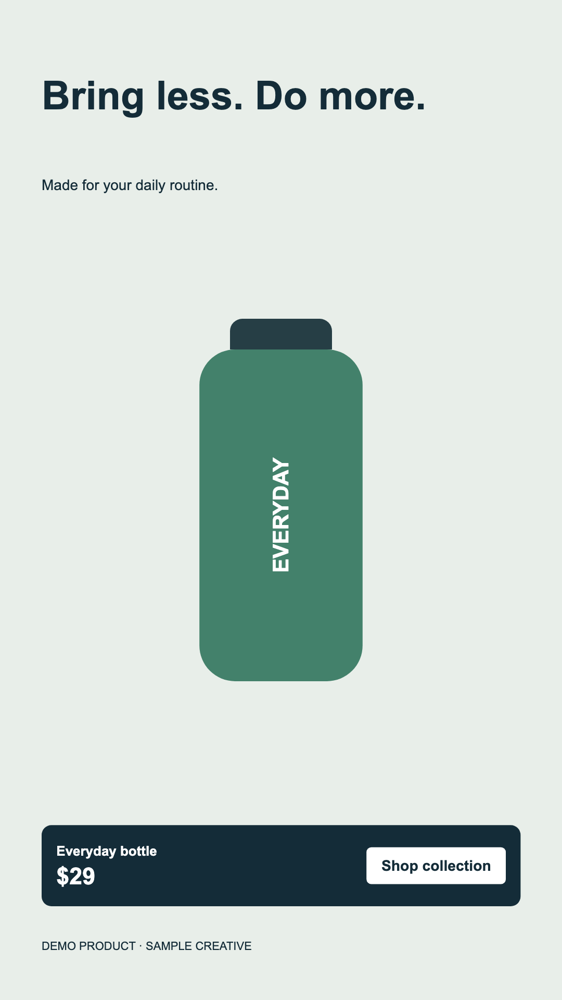

# Video workflow recipes

Runnable examples from [VideoGen](https://videogen.io/) for combining generated media with programmatic video editing.

## Remotion product ad

Six-second portrait composition and an editable offer lower third. The default demo uses synthetic CSS artwork and requires no account, credentials or generation credits.

```sh
cd remotion
npm ci
npm run typecheck
npm run still
npm run render
npm run overlay
```



`src/OfferLowerThird.tsx` is a focused Remotion Interactive component: editable product name, price, call to action and colors, with duration-aware entrance/exit. Its root style controls position; animation stays inside that root. No remote fonts or assets.

### Optional generated media

Node22+ required. Creating a workflow spends VideoGen credits. Keep your API key in your environment, never in source. The default commands above never invoke generation.

```sh
export VIDEOGEN_API_KEY=your_key
node generate-media.mjs --allow-credit-spend
npm run render -- --props=generated.props.json
```

The script starts one workflow, polls status and downloads the returned `downloadUrl`. If interrupted, use the printed `--resume=...` argument to poll the existing run without creating another. The paid generation path is schema-checked but has not been run for this demo. See [API docs](https://docs.videogen.io/) or [MCP setup](https://videogen.io/videogen-mcp).

For existing media, place a six-second-or-longer MP4 in `remotion/public/` and set `mediaFile` in your props JSON to its filename. The composition trims to six seconds. The demo product is fictional; generated visuals must be reviewed before use.

## MoviePy delivery variants

Contain a whole source in portrait and square canvases without cropping product details. Preserves duration and audio; optionally cap duration for a quick preview.

```sh
python3 -m venv .venv
.venv/bin/pip install -r moviepy/requirements.txt
.venv/bin/python moviepy/contain_variants.py remotion/previews/product-ad.mp4 --output-dir moviepy/out
```

Uses MoviePy2.x imports, H.264/AAC and yuv420p. Accepts any local video you have permission to edit, including a downloaded VideoGen export; makes no API calls. Change `contain_clip`'s background tuple to customize the canvas.

## Versions and license

Remotion packages are pinned together at4.0.538, React19.2.1, TypeScript5.9.3, MoviePy2.2.1. A small ambient declaration bridges Remotion's published Bun Timer reference to Node's timeout type; third-party declaration checking remains enabled. Explicit type inclusion prevents duplicate WebCodecs ambient declarations. The existing transitive Zod dependency is overridden to4.6.6 to address GHSA-mrhx-c7xc-m3w5. Remotion emits a version advisory because it expects Zod4.5.4; the patched4.6.6 override passes the renders and checks here.

The source is MIT licensed; Remotion has [separate commercial license requirements](https://www.remotion.dev/license). Synthetic demo art is included. Maintained by VideoGen, with AI assistance. Independent examples, not endorsements by Remotion or MoviePy.

## Agent framework integrations

Official VideoGen tool adapters, with optional tool allowlists and account/API-key setup:

- [CrewAI](integrations/crewai-videogen)
- [Pydantic AI](integrations/pydantic-ai-videogen)
- [OpenAI Agents SDK for Python](integrations/openai-agents-videogen)
- [Vercel AI SDK](integrations/ai-sdk-videogen)
- [OpenAI Agents SDK for TypeScript](integrations/openai-agents-typescript)

Generation uses VideoGen credits. Obtain user approval before credit-consuming calls; use read-only tool allowlists when appropriate.
